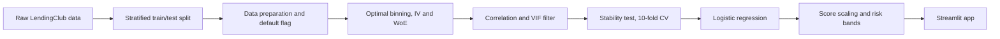

## Objective
This repository demonstrates an end-to-end behavioral credit scorecard development process, covering data wrangling, feature engineering, variable selection, model development, performance evaluation, and deployment through a digital dashboard. 

# Behavioral Credit Scorecard
A behavioral credit scorecard is a credit risk model for prediction of probability of default of existing borrowers. Financial institutions develop behavioral scorecards typically for 6/12 months mature loans. As input, a behavioral credit risk model takes borrower's personal, financial, credit bureau and existing loan repayment data. Financial institutions use it after disbursement to monitor the portfolio, spot deteriorating accounts early, and support collections and limit decisions.

## Data Description

| Item | Detail |
|---|---|
| Source | LendingClub loan data |
| Scope | Individual (non-joint) loans issued from 2010 onward |
| Observation date | 2016-01-01 (set in the preprocessing config) |
| Minimum seasoning | Loans with 12 months or less since issue are excluded |
| Target | `default_flag` (1 = default, 0 = non-default) |
| Split | Stratified train/test split on the target, done before any processing |

**Default definition**

- `default_flag = 1` for loan status Charged Off, Default, or Does not meet the credit policy (Charged Off).
- `default_flag = 1` for loan status Late (31-120 days) with 4 or more months overdue.
- All other loans are `0`.

**Data cleaning and derived fields**

- Columns with more than 90% missing values are dropped.
- Missing values in delinquency and derogatory fields are filled with 0, as they indicate no record.
- Charged-off loans with zero overdue months are dropped.
- Rows with conflicting logic are dropped, for example `revol_util = 0` with a non-zero `revol_bal`.
- Rare home ownership categories (OTHER, NONE, ANY) are dropped.
- Derived fields: `credit_history_length` (months), `loan_to_annl_inc`, `mnths_loan_sanct`, and `MOD` (months overdue).

**Variables in the scorecard**

| Variable | Description | Type | Direction |
|---|---|---|---|
| grade | Risk grade assigned to the loan (A to G) | Text | A is lowest risk, G is highest |
| term | Loan term (36 or 60 months) | Text | 60 months is generally riskier |
| purpose | Stated purpose of the loan | Text | Varies by category |
| verification_status | Whether income was verified | Text | Varies by category |
| initial_list_status | w = whole loan, f = fractional loan | Text | Varies by category |
| loan_amnt | Loan amount | Float | Higher is riskier |
| annual_inc | Annual income | Float | Higher is better |
| tot_coll_amt | Total amount sent to collections | Float | Higher is worse |
| total_rec_int | Total interest received | Float | Higher is better |
| inq_last_6mths | Credit inquiries in the last 6 months | Integer | Higher is worse |
| credit_history_length | Credit history length (months) | Integer | Higher is better |
| revol_util | Revolving credit utilization (%) | Float | Higher is worse |
| dti | Debt-to-income ratio | Float | Higher is worse |

## Scorecard Development Process



1. **Split:** the data is split into train and test sets before any processing to prevent leakage.
2. **Prepare:** loans are filtered, the default flag is defined, and conflicting rows are removed.
3. **Bin and transform:** each variable is optimally binned with `optbinning` and replaced by its Weight of Evidence (WoE).
4. **Select variables:** variables are filtered by IV, correlation, VIF, and stability across folds.
5. **Model:** a logistic regression is trained on the WoE values and tracked in MLflow.
6. **Scale:** model output is converted to scorecard points, and risk bands and a default cutoff are applied.
7. **Deploy:** the scorecard is served through a Streamlit app.

## Feature Selection Process

1. **Information Value (IV):** variables with IV below the configured threshold are removed.
2. **Correlation and VIF:** among pairs correlated above the threshold, the variable with the higher VIF is dropped, repeating until no pair remains.
3. **Stability test:** a stratified 10-fold cross-validation refits the binning and model on each fold's training rows only.
4. **Stability criteria:** a variable is kept if its coefficient CV is below 0.10 and its coefficient sign is consistent in at least 90% of folds.
5. **Output:** the stable variable list, fitted WoE transformer, and WoE table are saved to the data folder.

Thresholds are set in `config.py`.

## Model Performance

| Dataset | AUC | Gini | KS |
|---|---|---|---|
| Train | 72.62% | 45.24% | 33.09% |
| Test | 72.59% | 45.18% | 33.25% |


## Scoring Process

The logistic regression output is converted into a score where a higher score means lower default risk.

**Model (log odds of default)**

```
ln(odds) = β0 + Σ βj × WoEj
```

**Scaling**

```
Factor = PDO / ln(2)
Offset = Base Score - Factor × ln(Base Odds)
Bin Points = WoEj * Coefficient + β0/No. of Features - Factor
Score = round( Offset + Σ Points of each variable's bin )
```

| Parameter | Value |
|---|---|
| Base score | 550 |
| Base odds (bad:good) | 9.73 |
| PDO (points to double the odds) | 20 |

1. Each variable value is mapped to its bin's WoE.
2. The WoE is multiplied by the model coefficient and the Factor to give the variable's points.
3. Points are summed with the offset, which appears as the "Offset" row in the app's points breakdown.
4. The total is rounded to the nearest integer to give the final score.

## Score Bands and Cutoff

Scores range from 433 to 640 and are grouped into 10-point bands, with the lowest band widened to 433-480.


| Score band | Bad rate |
|---|---|
| 433-480 | 42.8% |
| 480-490 | 42.4% |
| 490-500 | 40.3% |
| 500-510 | 31.9% |
| 510-520 | 26.1% |
| 520-530 | 19.8% |
| 530-540 | 14.7% |
| 540-550 | 11.2% |
| 550-560 | 7.9% |
| 560-570 | 5.8% |
| 570-580 | 4.0% |
| 580-590 | 2.7% |
| 590-600 | 2.0% |
| 600-610 | 1.1% |
| 610-620 | 1.0% |
| 620-630 | 0.5% |
| 630-640 | 0.0% |

The bad rate falls steadily as the score rises, which confirms the scorecard rank-orders risk.

**Cutoff selection**

1. Borrowers were scored and grouped into score bands, and the bad rate was calculated for each band.
2. Band bad rates were compared with the population default rate of 9.73%.
3. Bands up to 540-550 (11.2%) have a bad rate above the population rate, and bands from 550-560 (7.9%) upward are below it.
4. The cutoff was set at 550, so scores below 550 are flagged as potential default.

## Takeaways

- Splitting before binning and fitting each cross-validation fold's WoE on its own training rows keeps validation results free of leakage.
- Combining IV, correlation, VIF, and coefficient stability yields a compact scorecard whose variable effects are consistent across samples.
- WoE binning keeps every variable's contribution to the score transparent, which supports explainability and review.
- The default definition and observation window drive the results, so any change to them requires re-running the full pipeline.
- `TBD: one-line summary of discriminatory power and stability.`
